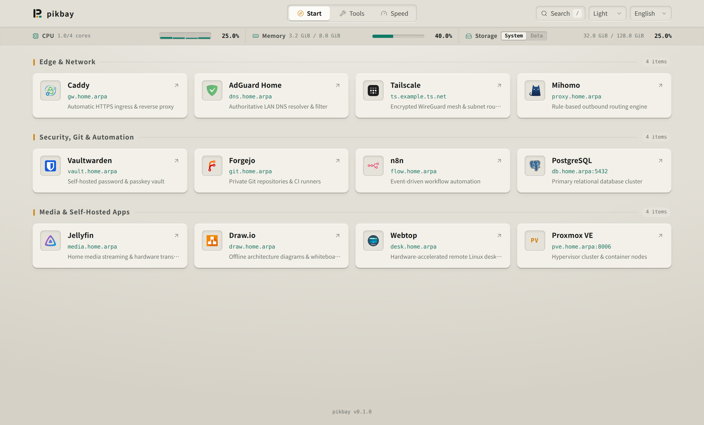
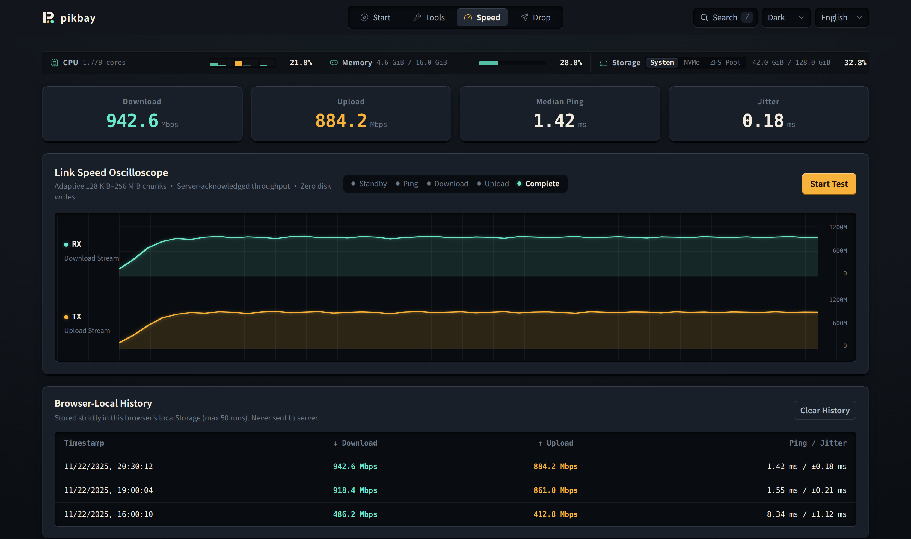
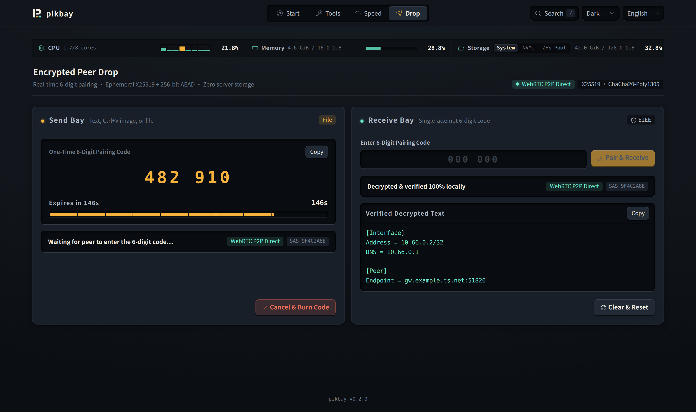
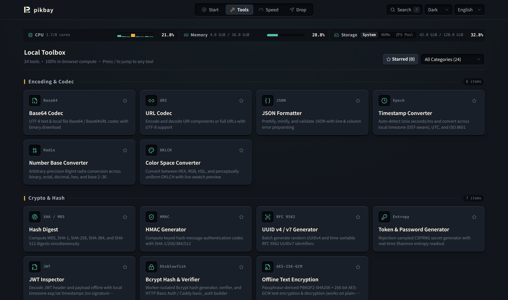

<!-- markdownlint-disable first-line-h1 no-inline-html -->

&nbsp;
<p align="center">
  <picture>
    <source media="(prefers-color-scheme: dark)" srcset="docs/images/banner-dark.svg">
    
  </picture>
</p>
<h3 align="center">Self-hosted startpage, streaming speedtest, local-only IT toolbox, and E2EE LAN drop in a single binary</h3>
<p align="center">
  Zero external requests · Zero database · Zero disk writes · Strict CSP (<code>default-src 'none'</code>)
</p>
<p align="center">
  <strong>English</strong> | <a href="./README.zh-CN.md">简体中文</a>
</p>
<p align="center">
  <a href="https://github.com/snakedreamy/pikbay/releases">
    
  </a>
  <a href="https://github.com/snakedreamy/pikbay/actions/workflows/ci.yml">
    
  </a>
  <a href="https://github.com/snakedreamy/pikbay/pkgs/container/pikbay">
    
  </a>
  <a href="./LICENSE">
    
  </a>
  <a href="./.github/CONTRIBUTING.md">
    
  </a>
</p>
<br/>
<p align="center">
  <picture>
    <source media="(prefers-color-scheme: dark)" srcset="docs/images/preview-startpage-dark.png">
    
  </picture>
</p>
<table align="center">
  <tr>
    <td align="center" width="33%">
      <br/>
      <sub><strong>Streaming Speedtest (<code>/speedtest</code>)</strong> — Dual-channel RX/TX oscilloscope &amp; browser-local history</sub>
    </td>
    <td align="center" width="33%">
      <br/>
      <sub><strong>Encrypted Peer Drop (<code>/drop</code>)</strong> — 6-digit X25519 + AEAD P2P transfer with zero server storage</sub>
    </td>
    <td align="center" width="33%">
      <br/>
      <sub><strong>Local IT Toolbox (<code>/tools</code>)</strong> — 25 lazy-loaded, 100% in-browser utilities with zero network calls</sub>
    </td>
  </tr>
</table>
<hr/>

<!-- markdownlint-enable first-line-h1 no-inline-html -->

**pikbay** consolidates a homelab **service startpage**, an end-to-end **network speedtest**, a **25-tool local-only developer & sysadmin toolbox**, and a **zero-storage encrypted peer-to-peer drop** into one self-contained Rust executable (`#![forbid(unsafe_code)]`) with all frontend assets embedded at compile time. It runs without a database, makes zero external network requests, and never writes state to disk—making it equally suited for Raspberry Pi / ARM SBCs, NAS boxes, bare-metal Linux hosts, and `--read-only` `FROM scratch` containers.

- [Why pikbay?](#why-pikbay)
- [Features](#features)
  - [Startpage & Hardware Status Strip (`/`)](#startpage--hardware-status-strip-)
  - [Streaming Network Speedtest (`/speedtest`)](#streaming-network-speedtest-speedtest)
  - [Peer-to-Peer Encrypted Drop (`/drop`)](#peer-to-peer-encrypted-drop-drop)
  - [100% In-Browser IT Toolbox (`/tools`, 25 Tools)](#100-in-browser-it-toolbox-tools-25-tools)
- [Getting Started](#getting-started)
  - [Option 1: Prebuilt Binary + `systemd` (Recommended for Bare Metal / SBCs)](#option-1-prebuilt-binary--systemd-recommended-for-bare-metal--sbcs)
  - [Option 2: Multi-Arch Container (`ghcr.io` / Docker / Podman)](#option-2-multi-arch-container-ghcrio--docker--podman)
- [Reverse Proxy & Public Hardening (Caddy / Nginx)](#reverse-proxy--public-hardening-caddy--nginx)
- [Runtime Parameters & Building from Source](#runtime-parameters--building-from-source)
- [Maintenance & Contribution Policy (No PRs)](#maintenance--contribution-policy-no-prs)
- [FAQ](#faq)
- [License](#license)

---

## Why pikbay?

When managing a personal server, homelab, or Tailscale tailnet, bookmarks, internal link speedtests, quick device-to-device file/snippet transfers, and everyday utilities (JWT, TOTP, YAML/TOML, Quadlet, CIDR, Cron, hashes, diffs) typically sprawl across separate containers—or worse, public online tool websites where pasting internal tokens, keys, or config snippets risks leaking credentials.

`pikbay` enforces four strict architectural boundaries:

| Guarantee | How `pikbay` enforces it |
|---|---|
| **Zero External Requests** | All scripts, styles, icons, and fonts are served same-origin from the embedded binary under `Content-Security-Policy: default-src 'none'`. WebRTC in `/drop` runs strictly with `iceServers: []` (zero external STUN/TURN servers). |
| **100% Client-Side Tools** | The backend exposes **zero** tool-processing endpoints. Static CI guards (`check-no-network.mjs`) forbid `fetch` / `WebSocket` / `XMLHttpRequest` / `RTCPeerConnection` inside `features/tools/**`, and tool inputs/outputs are never written to `localStorage`. |
| **Zero Backend Disk Writes** | Configuration and custom icons are loaded read-only; sessions and `/drop` pairing rooms live strictly in bounded RAM. Flash media (`SD / eMMC / UFS`) suffers zero wear, and containers run cleanly with `--read-only`. |
| **Defense-in-Depth Exposure** | Defaults bind to `127.0.0.1:8080` for zero-friction local/VPN access. Public reverse-proxy deployments add Argon2id single-user auth (`[auth]`), CIDR-verified `trusted_proxies`, `allowed_hosts` (`421`), and same-origin Fetch Metadata / `Origin` guards. |

---

## Features

### Startpage & Hardware Status Strip (`/`)

- **4-Column Responsive Bookmark Grid**: Organizes services by `[[groups]]` across a widescreen `88rem` (`1408px`) symmetric grid (`4 → 3 → 2 → 1` columns) displaying service titles, hosts, and descriptions.
- **Sandboxed Custom Icons + Automatic Monograms**: Drop `.svg`, `.png`, `.webp`, or `.ico` files into `./icons/` (see [`icons/README.md`](./icons/README.md)). Custom SVGs are served with atomic `O_NOFOLLOW` symlink rejection on Unix (`symlink_metadata` check on Windows) and an isolated `sandbox` CSP header via ``. When an icon is omitted or missing, `pikbay` renders an engraved 1–3 character monogram badge (`icon_text` or auto-derived initials).
- **1-Second Hardware Telemetry Strip**: Docked directly beneath the top bar (pauses automatically when the browser tab is hidden):
  - **CPU**: Reads host `/proc/stat` total utilization and up to 16 per-core spectrum buckets on bare metal / `systemd`, automatically switching to cgroup v2 quota accounting inside CPU-capped (`--cpus`) containers.
  - **Memory**: Reports `/proc/meminfo` working memory on hosts, or cgroup v2 working-set usage inside memory-capped (`-m`) containers.
  - **Zero-Config Multi-Disk Discovery**: Scans `/proc/self/mountinfo` and `/sys/block` on an isolated non-blocking worker thread (so unresponsive NFS/SMB mounts never stall startup or HTTP responses), resolves LVM/LUKS `dm-*` chains, deduplicates subvolumes, and classifies `UFS / NVMe / SD / eMMC / SSD / HDD / ZFS / NAS`.

### Streaming Network Speedtest (`/speedtest`)

- **End-to-End Parallel Throughput**: 20 sequential RTT probes (cold-start sample discarded; median latency + consecutive jitter) followed by parallel adaptive-chunk download and upload streams (2-second warmup, 200ms sampling ticks). Upload throughput is measured from server-confirmed byte counts (`POST /api/speed/up` starting at `128 KiB`), preventing false readings caused by local socket/proxy buffering on port-forwarded links.
- **Unsmoothed Dual-Channel Oscilloscope**: Plots raw 200ms `RX` and `TX` `<polyline>` traces with dynamic scale ticks so real TCP slow-start bursts and link jitter remain visible.
- **Browser-Local History & Server Quotas**: Stores up to 50 recent runs strictly in your browser's `localStorage` (`pikbay:v1:speedtest-history`). On the server, upload chunks are counted and discarded in memory, protected by per-IP token buckets, concurrency semaphores, and local-timezone daily traffic quotas (`daily_quota_gb`) with automatic abort refunds.

### Peer-to-Peer Encrypted Drop (`/drop`)

- **One-Time 6-Digit Pairing & Single-Attempt Burn**: Open `/drop` on two devices simultaneously to transfer text snippets, `Ctrl+V` clipboard screenshots, or arbitrary files without accounts or persistent server buffers. Each 6-digit code (`code_ttl_seconds = 180`) allows **strictly one** join attempt—wrong codes, MAC mismatches, or mid-transfer disconnects immediately destroy the room.
- **Ephemeral X25519 + PIN-Bound 256-Bit AEAD**: Both browsers generate ephemeral X25519 key pairs and derive session keys via `HKDF-SHA256` bound to both random salts and the 6-digit PIN. Metadata (filename, MIME, byte length) is encrypted and sent **only after** mutual Key Confirmation MACs succeed; payloads stream in `64 KiB` **ChaCha20-Poly1305** chunks with monotonic sequence numbers and an authenticated EOF frame (works identically on HTTPS and plain-HTTP LAN IPs).
- **WebRTC Direct + Automatic Zero-Storage Ciphertext Relay Fallback**: Negotiates a direct LAN `RTCDataChannel` (`iceServers: []`, zero external STUN/TURN calls) so bytes bypass the server completely. When Wi-Fi AP isolation, container NAT, or cross-subnet routing blocks P2P after 3 seconds, `/drop` seamlessly streams the exact same AEAD ciphertext chunks through `/api/drop/ws` with bounded backpressure (`max_relay_mb = 256`) and zero server storage (compare SAS codes on both screens when pairing across untrusted networks).

### 100% In-Browser IT Toolbox (`/tools`, 25 Tools)

Includes **25 lazy-chunked developer & sysadmin utilities** (architected for 100+ tools via auto-discovered `catalog/<tool-id>/` plugins), with pure-TypeScript fallbacks so digests, TOTP, and AEAD encryption work even on plain-HTTP private LAN IPs:

| Category | Built-in Tools |
|---|---|
| **Encoding & Formats** | `Base64 Codec` (Standard / URL-Safe + binary file import/export), `URL Codec`, `JSON Formatter & Validator` (lossless 64-bit integers + exact line/column error locator), `YAML · JSON · TOML Converter` (three-way config converter & line/col validator), `Timestamp Converter` (auto s/ms, local DST & ISO 8601), `Radix Converter` (`BigInt` base 2–36), `Color Space Converter` (`HEX / RGB / HSL / OKLCH`) |
| **Crypto & Tokens** | `Hash Digest` (`SHA-1 / SHA-256 / SHA-384 / SHA-512` & `MD5`), `HMAC Generator`, `Bcrypt Hash & Verifier` (Web Worker cost-adjustable `$2b$` + `.htpasswd` & Caddy `basic_auth`), `Offline Text Encryption` (`PBKDF2-SHA256` + `AES-256-GCM` `PKB1` armor), `UUID v4 / v7 Generator`, `Password & Token Generator` (rejection-sampled CSPRNG + Shannon entropy), `JWT Offline Inspector`, `TOTP Generator` (RFC 6238 Base32 & `otpauth://` with Previous / Current / Next windows) |
| **Text, Diff & Web** | `Text & File Diff` (dual file drop, NUL-byte binary SHA-256 check, Split/Unified views, collapsible context & trailing-space toggle), `Regex Tester` (capture table + Web Worker 800ms ReDoS timeout), `Text Stats & Case Converter` (graphemes, code points, UTF-8/UTF-16 sizes, CJK & words, `LF/CRLF` detection, reading time, token frequency & 9 naming styles), `URL Parser & Builder` (interactive Query parameter table & live URL reconstruction), `Device & Browser Inspector` (physical pixels, live `Hz` refresh rate, Client Hints, WebGL/WebGPU renderer, 1080p60 hardware codec matrix & Markdown/JSON report) |
| **Network & Ops** | `IPv4 / IPv6 Subnet Calculator` (`BigInt` CIDR math, RFC 3021 `/31` & RFC 5952 compression), `Chmod Calculator` (POSIX `rwx` + `SUID / SGID / Sticky` matrix ↔ octal/symbolic/CLI), `Docker / Quadlet Converter` (`docker/podman run` → `compose.yaml` & Podman `.container` Quadlet), `Cron Parser` (5/6-field Vixie Cron + next 8 local runs), `QR Code Generator` (`SVG` & `PNG` export) |

Press `/` or `⌘K` (`Ctrl+K`) anywhere to open the global command palette and search bookmarks, hosts, workspaces, and all 25 tools across **English** and **Simplified Chinese (`简体中文`)**.

---

## Getting Started

### Option 1: Prebuilt Binary + `systemd` (Recommended for Bare Metal / SBCs)

#### Step 1: Download & Prepare Directory Permissions

Download the archive for your platform (`x86_64-unknown-linux-musl`, `aarch64-unknown-linux-musl`, `aarch64-apple-darwin`, `x86_64-apple-darwin`, or `x86_64-pc-windows-msvc`) from [GitHub Releases](https://github.com/snakedreamy/pikbay/releases) and verify `SHA256SUMS.txt`:

```bash
# Example for Linux x86_64 (replace with aarch64-unknown-linux-musl on ARM64 SBCs/servers)
VERSION="v0.2.0"
ARCH="x86_64-unknown-linux-musl"
curl -fLO "https://github.com/snakedreamy/pikbay/releases/download/${VERSION}/pikbay-${VERSION}-${ARCH}.tar.gz"
curl -fLO "https://github.com/snakedreamy/pikbay/releases/download/${VERSION}/SHA256SUMS.txt"
grep "pikbay-${VERSION}-${ARCH}.tar.gz" SHA256SUMS.txt | sha256sum -c -

tar -xzf "pikbay-${VERSION}-${ARCH}.tar.gz"
cd "pikbay-${VERSION}-${ARCH}"

# Create a dedicated unprivileged system account and install with least-privilege permissions
sudo useradd --system --no-create-home --shell /usr/sbin/nologin pikbay || true
sudo mkdir -p /opt/pikbay/icons
sudo install -m 0755 pikbay /opt/pikbay/pikbay
sudo install -m 0640 -o root -g pikbay config.example.toml /opt/pikbay/config.toml
sudo chown -R root:pikbay /opt/pikbay
sudo chmod 0750 /opt/pikbay /opt/pikbay/icons
# Optional: place custom bookmark icons (.svg / .png / .webp / .ico, mode 0640, group pikbay) in /opt/pikbay/icons/
```

By default, `server.listen = "127.0.0.1:8080"` listens on local loopback only (ideal for local use or a co-located reverse proxy). To allow direct access from other devices on a trusted LAN, change `listen` in `/opt/pikbay/config.toml` to `"0.0.0.0:8080"` or a specific LAN interface IP.

#### Step 2: Configure `systemd` Service

Create `/etc/systemd/system/pikbay.service`:

```ini
[Unit]
Description=pikbay Personal Web Console
After=network-online.target
Wants=network-online.target

[Service]
Type=simple
User=pikbay
Group=pikbay
WorkingDirectory=/opt/pikbay
Environment=PIKBAY_CONFIG=/opt/pikbay/config.toml
Environment=PIKBAY_LOG=info
ExecStart=/opt/pikbay/pikbay
Restart=on-failure
RestartSec=3
NoNewPrivileges=true
ProtectSystem=strict
ProtectHome=read-only

[Install]
WantedBy=multi-user.target
```

Enable and start the service:

```bash
sudo systemctl daemon-reload
sudo systemctl enable --now pikbay

# Verify liveness and running version
curl -fsS http://127.0.0.1:8080/healthz
curl -fsS http://127.0.0.1:8080/api/meta
```

- **Upgrading & Rollback**: Replace `/opt/pikbay/pikbay` with the new binary (`./pikbay --version`) and run `sudo systemctl restart pikbay`. Existing `v0.1.0` `config.toml` files (`version = 1`) work with `v0.2.0` without modification (`[drop]` defaults apply automatically). If a future major release ever changes `version`, `pikbay` refuses to start rather than mutating your file in place, allowing instant rollback by restoring the previous binary.

---

### Option 2: Multi-Arch Container (`ghcr.io` / Docker / Podman)

Official `FROM scratch` multi-architecture images (`linux/amd64` and `linux/arm64`, running as non-root UID `65532:65532`) are published to GitHub Container Registry.

```bash
mkdir -p /srv/pikbay/icons
cp config.example.toml /srv/pikbay/pikbay.toml
# Note: when using bridge networking (`-p 127.0.0.1:8080:8080`), set `listen = "0.0.0.0:8080"` inside /srv/pikbay/pikbay.toml
chmod 0644 /srv/pikbay/pikbay.toml

docker run -d \
  --name pikbay \
  --restart unless-stopped \
  --read-only \
  --cap-drop=ALL \
  --security-opt=no-new-privileges:true \
  -u 65532:65532 \
  -p 127.0.0.1:8080:8080 \
  -v /etc/localtime:/etc/localtime:ro \
  -v /srv/pikbay/pikbay.toml:/config/pikbay.toml:ro \
  -v /srv/pikbay/icons:/config/icons:ro \
  ghcr.io/snakedreamy/pikbay:latest
```

- Mounting `/etc/localtime:/etc/localtime:ro` lets the `scratch` container resolve your local timezone so `speedtest.daily_quota_gb` resets accurately at local midnight.
- To monitor additional host disks inside a container (e.g., `/mnt/nvme`, `/mnt/nas`), mount them read-only (`-v /mnt/nvme:/mnt/nvme:ro`); `pikbay` will discover and classify them automatically.

---

## Reverse Proxy & Public Hardening (Caddy / Nginx)

> [!IMPORTANT]
> Default settings (`auth.enabled = false`, `speedtest.enabled = true`, `drop.enabled = true`, `allowed_hosts = []`) are intended for localhost or private VPNs (such as Tailscale / WireGuard). Before exposing `pikbay` behind a public reverse proxy, enable **TLS + `[auth]` + `server.allowed_hosts`**.

### 1. Generate an Argon2id Password Hash

`pikbay hash-password` reads the password from `stdin` so plaintext never appears in shell history or `ps`:

```bash
# Bare metal:
./pikbay hash-password

# Container:
docker run --rm -i ghcr.io/snakedreamy/pikbay:latest hash-password
```

Update `config.toml` (supply **only one** password source across `auth.password_hash`, `auth.password`, `PIKBAY_AUTH_PASSWORD`, or `PIKBAY_AUTH_PASSWORD_HASH`—ambiguous multi-source setups abort startup):

```toml
[server]
listen = "127.0.0.1:8080"
trusted_proxies = ["127.0.0.1/32", "::1/128"]   # Add your proxy container CIDR if not co-located on loopback
allowed_hosts = ["pikbay.example.com"]           # Direct IP scans & unknown Hosts receive an empty 421 response

[auth]
enabled = true
username = "admin"
password_hash = "$argon2id$v=19$m=19456,t=2,p=1$..."
session_ttl_hours = 168
```

### 2. Caddyfile Example (Disable Compression & Buffering on `/api/speed/*`)

```caddyfile
pikbay.example.com {
    header Strict-Transport-Security "max-age=31536000; includeSubDomains"

    # Critical: disable reverse-proxy compression and request/response buffering on speedtest streams
    @speedtest path /api/speed/*
    handle @speedtest {
        reverse_proxy 127.0.0.1:8080 {
            flush_interval -1
            request_buffers 0
            response_buffers 0
        }
    }

    # Caddy forwards `/api/drop/ws` WebSocket upgrades and Origin headers automatically
    handle {
        encode zstd gzip
        reverse_proxy 127.0.0.1:8080
    }
}
```

For **Nginx**, forward `X-Forwarded-For`, `X-Forwarded-Proto`, `X-Forwarded-Host`, and `Origin`, set `client_max_body_size 64m;` (matching `speedtest.max_upload_mb`), configure `proxy_buffering off; proxy_request_buffering off; gzip off;` on `location /api/speed/`, and enable WebSocket upgrade headers (`proxy_http_version 1.1; proxy_set_header Upgrade $http_upgrade; proxy_set_header Connection "upgrade";`) on `location = /api/drop/ws`.

---

## Runtime Parameters & Building from Source

### Environment Variables & CLI Flags

| Name | Default | Description |
|---|---|---|
| `PIKBAY_CONFIG` | `./config.toml` (`/config/pikbay.toml` in container) | Read-only TOML configuration path |
| `PIKBAY_LOG` | `info` | `tracing` log filter (`error`, `warn`, `info`, `debug`), written to `stdout` |
| `PIKBAY_AUTH_PASSWORD` | — | Optional plaintext password injected via environment (hashed into Argon2id in memory at startup) |
| `PIKBAY_AUTH_PASSWORD_HASH` | — | Optional Argon2id PHC hash string injected via environment |
| `pikbay hash-password` | — | Reads a password line from `stdin` and outputs an Argon2id PHC hash |
| `pikbay --version` / `-V` | — | Prints version and embedded Git commit (`pikbay 0.2.0 (...)`) |

### Building & Verifying from Source

Prerequisites: **Rust stable (`>= 1.88`)**, **Node.js `>= 24`**, and Chrome/Chromium (for Playwright E2E).

```bash
# 1. Frontend static guards (licenses, zero-network/CSP, i18n parity, 4-layer architecture), typecheck, Vitest & bundle
cd web
npm ci
npm run lint:guards
npm run check
npm test
npm run build

# 2. Backend unit/integration tests, dependency license/advisory audit & single-binary release build
cd ..
RUSTFLAGS="-D warnings" cargo test --locked
cargo deny check
RUSTFLAGS="-D warnings" cargo build --release --locked

# 3. End-to-end Playwright suite against the compiled release binary (isolated on port 18080 & OS temp dir)
cd web
npm run e2e
```

---

## Maintenance & Contribution Policy (No PRs)

`pikbay` is a personal project built for the author's own homelab and published as open source in case it is useful to others.

- **Pull requests are not accepted.** Reviewing external code, coordinating design changes, and maintaining community-contributed features require ongoing effort that the author chooses not to take on. Please see [CONTRIBUTING.md](./.github/CONTRIBUTING.md) for details.
- **Feature requests** outside the current scope are not planned. You are encouraged to fork `pikbay` and tailor it to your own needs under the terms of the `AGPL-3.0-only` license.
- **Reproducible bug reports** ([Issue Template](https://github.com/snakedreamy/pikbay/issues/new?template=bug_report.yml)) and private **security disclosures** ([SECURITY.md](./SECURITY.md)) are welcome on a best-effort basis.

---

## FAQ

**1. Why does the speedtest return `429 Too Many Requests` or `413 Payload Too Large`?**
- `429` means a per-IP rate limit (`per_ip_requests_per_minute = 600`), concurrency cap, or daily quota (`daily_quota_gb = 200`, `0` = unlimited) was reached. Behind a reverse proxy, ensure `server.trusted_proxies` includes the proxy's IP/CIDR so all users do not share a single rate-limit bucket.
- `413` during upload usually comes from an upstream reverse proxy body limit (e.g., Nginx's default `client_max_body_size 1m`).

**2. Why does a bookmark show a 2-letter monogram instead of my file in `icons/`?**
- Verify `icon` contains only the filename (e.g., `"jellyfin.svg"`—ASCII alphanumeric, `.`, `_`, `-`, with extension `.svg`, `.png`, `.webp`, or `.ico`; subdirectories and symlinks are rejected) and that the service user has read permissions on the file.

**3. Why did `/drop` switch from `WebRTC P2P Direct` to `Zero-Storage WS Relay`?**
- When Wi-Fi AP client isolation, symmetric NAT, container bridge networking, or cross-VLAN firewall rules prevent direct browser-to-browser UDP/TCP connectivity within 3 seconds, `/drop` automatically streams the exact same X25519 + ChaCha20-Poly1305 AEAD ciphertext chunks through `/api/drop/ws` (up to `drop.max_relay_mb`, default `256 MiB`). Passive relays never see plaintext, filenames, or keys, and `pikbay` retains zero bytes in memory once chunks pass through (across untrusted networks, compare the SAS fingerprint displayed on both devices).

**4. Why do sessions sign out after restarting `pikbay`, while speedtest history persists?**
- To guarantee zero disk writes, `pikbay` generates a fresh 256-bit CSPRNG HMAC signing key in RAM on every startup. Speedtest history lives exclusively in your browser's `localStorage`.

---

## License

Copyright (C) 2026 `snakedreamy`.

Licensed under the **GNU Affero General Public License v3.0 only (`AGPL-3.0-only`)** — see [LICENSE](./LICENSE) for the full text. If you run a modified version of `pikbay` over a network for external users, Section 13 of the GNU AGPLv3 requires making the complete Corresponding Source of that modified version available to those users under the same license.
