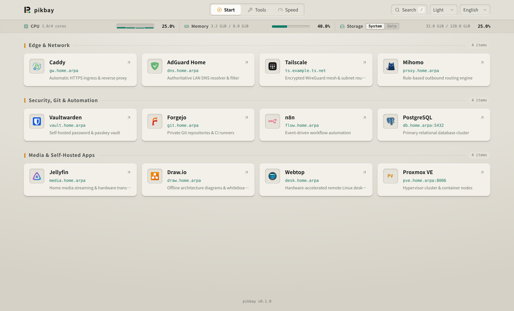
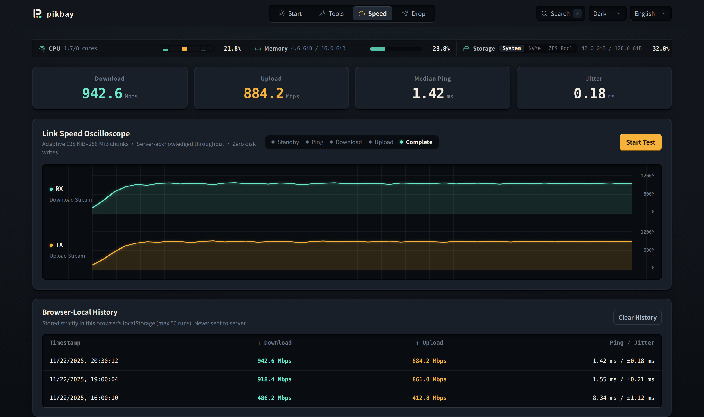
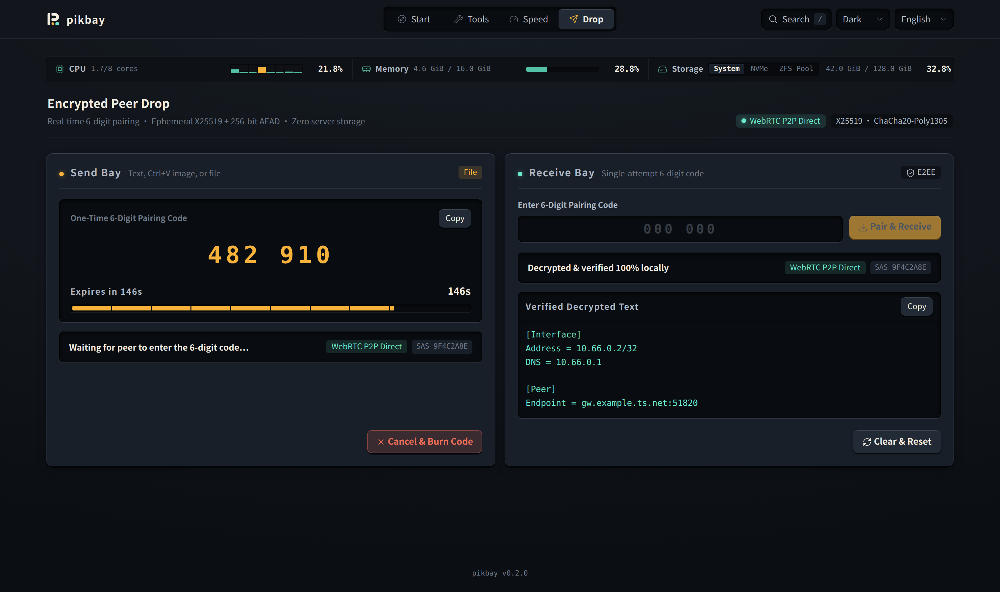
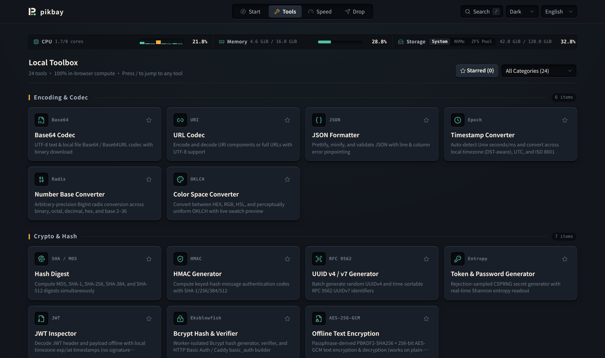

<!-- markdownlint-disable first-line-h1 no-inline-html -->

&nbsp;
<p align="center">
  <picture>
    <source media="(prefers-color-scheme: dark)" srcset="docs/images/banner-dark.svg">
    
  </picture>
</p>
<h3 align="center">自托管单二进制个人起始页、流式网络测速、纯本地 IT 工具箱与端到端加密闪传</h3>
<p align="center">
  零外部请求 · 零数据库依赖 · 零磁盘状态写入 · 严格 CSP（<code>default-src 'none'</code>）
</p>
<p align="center">
  <a href="./README.md">English</a> | <strong>简体中文</strong>
</p>
<p align="center">
  <a href="https://github.com/snakedreamy/pikbay/releases">
    
  </a>
  <a href="https://github.com/snakedreamy/pikbay/actions/workflows/ci.yml">
    
  </a>
  <a href="https://github.com/snakedreamy/pikbay/pkgs/container/pikbay">
    
  </a>
  <a href="./LICENSE">
    
  </a>
  <a href="./.github/CONTRIBUTING.md">
    
  </a>
</p>
<br/>
<p align="center">
  <picture>
    <source media="(prefers-color-scheme: dark)" srcset="docs/images/preview-startpage-dark.png">
    
  </picture>
</p>
<table align="center">
  <tr>
    <td align="center" width="33%">
      <br/>
      <sub><strong>流式网络测速（<code>/speedtest</code>）</strong> — RX/TX 双通道实时折线示波与浏览器本地历史</sub>
    </td>
    <td align="center" width="33%">
      <br/>
      <sub><strong>加密闪传（<code>/drop</code>）</strong> — 双端 6 位码 X25519 + AEAD 直传，服务端零留存</sub>
    </td>
    <td align="center" width="33%">
      <br/>
      <sub><strong>纯本地 IT 工具箱（<code>/tools</code>）</strong> — 25 个按需懒加载、100% 浏览器本地计算工具</sub>
    </td>
  </tr>
</table>
<hr/>

<!-- markdownlint-enable first-line-h1 no-inline-html -->

**pikbay** 将个人实验室（Homelab）高频使用的**服务导航起始页、端到端网络测速、25 项纯本地研发运维工具箱与双端零存储加密闪传**收敛进同一个零外部依赖的单二进制 Web 应用中。后端基于 Rust（`#![forbid(unsafe_code)]`）在编译期完整内嵌前端静态产物，无需数据库、运行期不写任何磁盘状态文件——既可以直接跑在树莓派、ARM 开发板、NAS 与普通 Linux 主机上，也原生支持 `FROM scratch` 极简 `--read-only` 容器部署。

- [解决什么问题](#解决什么问题)
- [功能概览](#功能概览)
  - [服务导航与实时硬件状态条（`/`）](#服务导航与实时硬件状态条-)
  - [局域网 / 组网隧道流式测速（`/speedtest`）](#局域网--组网隧道流式测速-speedtest)
  - [局域网双端 6 位码加密闪传（`/drop`）](#局域网双端-6-位码加密闪传drop)
  - [100% 浏览器本地 IT 工具箱（`/tools`，25 项工具）](#100-浏览器本地-it-工具箱tools25-项工具)
- [快速安装与部署](#快速安装与部署)
  - [方式一：预编译单二进制 + `systemd`（推荐裸机 / 开发板 / 主机）](#方式一预编译单二进制--systemd推荐裸机--开发板--主机)
  - [方式二：多架构容器部署（`ghcr.io` / Docker / Podman）](#方式二多架构容器部署ghcrio--docker--podman)
- [反向代理与公网暴露加固（Caddy / Nginx）](#反向代理与公网暴露加固caddy--nginx)
- [运行参数与从源码构建](#运行参数与从源码构建)
- [维护说明与贡献策略（不接受 PR）](#维护说明与贡献策略不接受-pr)
- [常见问题（FAQ）](#常见问题faq)
- [开源协议](#开源协议)

---

## 解决什么问题

日常维护个人设备、家庭服务器或异地组网（Tailscale / WireGuard）环境时，书签面板、内网链路测速、跨设备临时传文件/配置片段以及编码/网段/令牌小工具往往分散在多个容器乃至公网第三方工具站中：把内网 JWT、TOTP 密钥或配置片段粘贴进外部在线工具存在泄露风险，而传统中转站又会在服务端落盘留存明文文件。

`pikbay` 用四条硬边界解决上述痛点：

| 核心边界 | 实现机制 |
|---|---|
| **零外部请求** | 所有脚本、样式、图标与字体 100% 同源内嵌，全局强制 `Content-Security-Policy: default-src 'none'`；`/drop` 的 WebRTC 固定 `iceServers: []`，绝不连接任何外部 STUN/TURN 或第三方 CDN。 |
| **工具 100% 本地计算** | 后端不提供任何工具处理接口；前端静态门禁（`check-no-network.mjs`）严禁工具目录调用 `fetch` / `WebSocket` / `RTCPeerConnection`，且工具输入与输出绝不写入 `localStorage`。 |
| **后端零磁盘写入** | 配置与自定义图标只读加载，登录会话与 `/drop` 瞬态配对槽位仅驻留受限内存；彻底避免开发板 `SD / eMMC / UFS` 闪存磨损，原生兼容 `--read-only` 容器。 |
| **内外网纵深防御** | 默认仅监听 `127.0.0.1:8080`，内网/VPN 直连即开即用；暴露公网反代时支持开启 Argon2id 单用户门禁（`[auth]`）、`trusted_proxies`、`allowed_hosts`（`421`）及同源 Fetch Metadata / `Origin` 校验。 |

---

## 功能概览

### 服务导航与实时硬件状态条（`/`）

- **宽屏 4 列对称书签矩阵**：主画幅 `88rem`（`1408px`），按 `[[groups]]` 组织服务卡片（随视口宽度按 `4 → 3 → 2 → 1` 列平滑自适应），清晰展示服务名称、主机名与说明。
- **自定义图标沙箱与刻字徽标兜底**：将 `.svg / .png / .webp / .ico` 放入 `./icons/` 目录即可在配置中按文件名引用（详见 [`icons/README.md`](./icons/README.md)）。后端在 Unix 下通过原子 `O_NOFOLLOW`（Windows 下经 `symlink_metadata`）拒绝符号链接越界，并为 `.svg` 响应注入独立 `sandbox` CSP 头且仅通过 `` 渲染；未填图标或文件缺失时，自动回退为 1~3 字符丝印文字徽标（优先取 `icon_text`，否则自动提取中英文缩写）。
- **1 秒实时硬件状态副栏**：紧贴顶栏下方常驻（浏览器切至后台标签页时自动暂停轮询）：
  - **CPU**：裸机 / `systemd` 默认读取 `/proc/stat` 整机总负载与最多 16 组多核频谱柱；运行在显式限制 `--cpus` 的容器内时自动切换为 cgroup v2 配额折算。
  - **内存**：默认读取 `/proc/meminfo` 整机可用内存；显式限制 `-m` 的容器按 cgroup v2 工作集折算。
  - **零配置多盘发现与隔离采样**：在独立防堆积后台线程中扫描 `/proc/self/mountinfo` 与 `/sys/block`（失联的 NFS/SMB 网络盘绝不拖住服务启动或阻塞 HTTP 响应），自动追溯 LVM/LUKS `dm-*` 底层物理设备、按文件系统去重并识别 `UFS / NVMe / SD / eMMC / SSD / HDD / ZFS / NAS`。

### 局域网 / 组网隧道流式测速（`/speedtest`）

- **并发自适应流式测量**：顺序 RTT 采样（剔除首包冷启动，计算中位延迟与相邻均值抖动）+ 多路并发自适应分块下载/上传测试（前 2 秒预热，按服务端 `per_ip_requests_per_minute` 自动规划探测与并发请求预算）。上传吞吐直接依据 `POST /api/speed/up` 服务端确认接收字节计数（`128 KiB` 小块起步双向自适应缩放），彻底消除远程端口转发与代理缓冲造成的失真。
- **双通道实时示波窗**：以 `100ms` 步进结合短期滑动窗口（约 `300ms`）绘制 `RX` / `TX` `<polyline>` 瞬时速率折线与动态量程参考刻度，兼顾慢启动爬升观测与帧间抖动平滑。
- **仅存当前浏览器的测速台账与服务端配额保护**：最近 50 次记录仅保存在当前浏览器 `localStorage` 中；服务端上传数据流边读边计数后当场丢弃，具备单 IP 令牌桶限流、并发信号量与本地时区每日流量配额（客户端中途取消下载时自动退还未消耗配额）。

### 局域网双端 6 位码加密闪传（`/drop`）

- **一次性 6 位数字配对与单次熔断**：两台设备同时打开 `/drop`，即可互传多行文本、`Ctrl+V` 剪贴板截图或任意文件。每个 6 位配对码（默认有效期 `180s`）**严格仅限单次配对尝试**——任何首次接入即刻锁死移除槽位，一旦校验失败或任一方断开连接，配对码当场销毁，杜绝在线轮询猜码。
- **一次性 X25519 + 配对码绑定 256 位认证加密**：双方浏览器各自生成一次性 X25519 密钥对，结合双方随机盐与 6 位数字码经 `HKDF-SHA256` 派生会话密钥；**先双向校验密钥确认码（MAC），通过后才加密发出文件名/大小等元数据**，正文与文件按 `64 KiB` 分片执行带严格递增序号的 **ChaCha20-Poly1305** 认证加密并附带显式 EOF 认证帧（兼容内网 IP 纯 HTTP 环境，绝不退回明文）。
- **WebRTC 点对点直连 + 零存储密文管道自动兜底**：优先通过 `RTCDataChannel`（`iceServers: []`）在两台设备间局域网高速直传，数据流完全绕开服务端；若遇路由器 AP 隔离、跨网段或容器桥接导致 3 秒内未直连成功，自动无缝切回当前 `/api/drop/ws` 连接按有界背压流式透传同一套 AEAD 密文分片（单次上限 `drop.max_relay_mb`，默认 `256 MiB`），服务端全程零数据留存、不解密载荷。

### 100% 浏览器本地 IT 工具箱（`/tools`，25 项工具）

内置 **25 个高频研发与网络运维工具**（插件架构支撑百级扩展），每个工具独立拆包按需懒加载，并针对局域网纯 HTTP 环境内置了纯 TypeScript 密码学与剪贴板回退实现：

| 分类 | 内置工具清单 |
|---|---|
| **编码与数据格式** | `Base64 编解码`（标准 / URL-Safe 及二进制文件互转）、`URL 编解码`、`JSON 格式化校验`（无损保留 64 位大整数 + 错误行列定位）、`YAML · JSON · TOML 互转`（三向配置转换、排版与精确行列语法校验）、`时间戳转换`（`自动 / 秒 / 毫秒` 切换，支持本地夏令时与 ISO 8601）、`进制转换`（`BigInt` 2~36 任意进制）、`颜色格式转换`（`HEX / RGB / HSL / OKLCH`） |
| **加密、哈希与令牌** | `哈希摘要计算`（`SHA-1 / SHA-256 / SHA-384 / SHA-512` 与 `MD5`）、`HMAC 消息认证码`、`Bcrypt 哈希与校验`（Web Worker 隔离计算 `$2b$` 哈希、口令验证及 `.htpasswd` / Caddy `basic_auth` 配置生成）、`文本口令加密`（`PBKDF2-SHA256` 随机盐 + `AES-256-GCM` 离线加解密，兼容内网纯 HTTP）、`UUID v4 / v7 生成`、`随机密码 / Token 生成`（CSPRNG 拒绝采样 + 香农熵）、`JWT 离线解析`、`TOTP 动态口令`（RFC 6238，支持 Base32 与 `otpauth://`，同屏展示上一期 / 当前 / 下一期口令） |
| **文本、对比与 Web** | `文本与文件对比`（支持左右双文件拖拽导入、二进制 NUL 检测与 SHA-256 比对、并排 Split / 合并 Unified 视图、折叠相同行与忽略行尾空白）、`正则表达式测试`（捕获组明细表 + 独立 Web Worker 800ms 防 ReDoS 超时）、`文本统计与命名转换`（视觉字素 / Unicode 码点 / UTF-8 与 UTF-16 长度、中英词数、换行符类型、阅读耗时、高频词统计 + 9 种命名风格）、`URL 解析与拼装`（协议/认证/主机/路径拆解 + 可逐行增删改的 Query 参数表实时回拼）、`设备与浏览器深度诊断`（物理像素、rAF 实测刷新率 `Hz`、Client Hints、WebGL/WebGPU 显卡型号、1080p60 硬解矩阵与 Markdown/JSON 报告复制） |
| **网络、容器与运维** | `IPv4 / IPv6 子网计算`（`BigInt` CIDR 计算，支持 RFC 3021 `/31` 与 RFC 5952 压缩）、`Chmod 权限计算`（Owner/Group/Other `rwx` + `SUID/SGID/Sticky` 矩阵双向联动八进制、符号串与命令）、`容器命令转 Compose / Quadlet`（自研分词器将 `docker/podman run` 转为 `compose.yaml` 与 **Podman `.container` Quadlet** 单元文件）、`Cron 表达式解析`（5/6 段解析与未来 8 次触发推算）、`二维码生成`（矢量 `SVG` 与高清 `PNG` 导出） |

在站内任意位置按 `/` 或 `⌘K`（`Ctrl+K`）即可唤起全局命令面板，支持中英双语即时检索书签、主机名、工作区与全部 25 项本地工具。

---

## 快速安装与部署

### 方式一：预编译单二进制 + `systemd`（推荐裸机 / 开发板 / 主机）

#### 步骤 1：下载对应架构发行包并配置最小权限

前往 [GitHub Releases](https://github.com/snakedreamy/pikbay/releases) 下载对应系统的预编译包（支持 `x86_64-unknown-linux-musl`、`aarch64-unknown-linux-musl`、`aarch64-apple-darwin`、`x86_64-apple-darwin`、`x86_64-pc-windows-msvc`）并校验 `SHA256SUMS.txt`：

```bash
# 以 Linux x86_64 为例（ARM64 设备请改为 aarch64-unknown-linux-musl）
VERSION="v0.3.0"
ARCH="x86_64-unknown-linux-musl"
curl -fLO "https://github.com/snakedreamy/pikbay/releases/download/${VERSION}/pikbay-${VERSION}-${ARCH}.tar.gz"
curl -fLO "https://github.com/snakedreamy/pikbay/releases/download/${VERSION}/SHA256SUMS.txt"
grep "pikbay-${VERSION}-${ARCH}.tar.gz" SHA256SUMS.txt | sha256sum -c -

tar -xzf "pikbay-${VERSION}-${ARCH}.tar.gz"
cd "pikbay-${VERSION}-${ARCH}"

# 创建专用无特权系统账号并配置最小只读权限
sudo useradd --system --no-create-home --shell /usr/sbin/nologin pikbay || true
sudo mkdir -p /opt/pikbay/icons
sudo install -m 0755 pikbay /opt/pikbay/pikbay
sudo install -m 0640 -o root -g pikbay config.example.toml /opt/pikbay/config.toml
sudo chown -R root:pikbay /opt/pikbay
sudo chmod 0750 /opt/pikbay /opt/pikbay/icons
# 可选：将自定义服务书签图标（.svg / .png / .webp / .ico，权限 0640，属组 pikbay）放入 /opt/pikbay/icons/
```

默认 `server.listen = "127.0.0.1:8080"` 仅监听本机回环；若需局域网内其他设备直接通过内网 IP 访问，将 `/opt/pikbay/config.toml` 中的 `listen` 改为 `"0.0.0.0:8080"` 或指定内网网卡地址即可。

#### 步骤 2：配置 `systemd` 守护服务

创建 `/etc/systemd/system/pikbay.service`：

```ini
[Unit]
Description=pikbay Personal Web Console
After=network-online.target
Wants=network-online.target

[Service]
Type=simple
User=pikbay
Group=pikbay
WorkingDirectory=/opt/pikbay
Environment=PIKBAY_CONFIG=/opt/pikbay/config.toml
Environment=PIKBAY_LOG=info
ExecStart=/opt/pikbay/pikbay
Restart=on-failure
RestartSec=3
NoNewPrivileges=true
ProtectSystem=strict
ProtectHome=read-only

[Install]
WantedBy=multi-user.target
```

启动并设为开机自启：

```bash
sudo systemctl daemon-reload
sudo systemctl enable --now pikbay

# 确认存活探针与运行版本
curl -fsS http://127.0.0.1:8080/healthz
curl -fsS http://127.0.0.1:8080/api/meta
```

- **升级与无损回退**：下载或编译新二进制（`./pikbay --version`）覆盖 `/opt/pikbay/pikbay` 后执行 `sudo systemctl restart pikbay`。旧版 `v0.1.0` / `v0.2.0` 配置文件（`version = 1`）无需任何修改即可直接平滑升级至 `v0.3.0`（未显式填写 `[drop]` 段时自动启用安全默认项）。若未来大版本调整了配置结构，`pikbay` 会在启动期直接拒绝启动而绝不修改旧配置文件，换回旧二进制即可立即回退。

---

### 方式二：多架构容器部署（`ghcr.io` / Docker / Podman）

官方多架构 `FROM scratch` 镜像（原生构建 `linux/amd64` 与 `linux/arm64`，默认非 root `65532:65532`）托管于 GitHub Container Registry：

```bash
mkdir -p /srv/pikbay/icons
cp config.example.toml /srv/pikbay/pikbay.toml
# 注意：使用桥接端口映射（-p 127.0.0.1:8080:8080）时，请将 /srv/pikbay/pikbay.toml 中的 listen 改为 "0.0.0.0:8080"
chmod 0644 /srv/pikbay/pikbay.toml

docker run -d \
  --name pikbay \
  --restart unless-stopped \
  --read-only \
  --cap-drop=ALL \
  --security-opt=no-new-privileges:true \
  -u 65532:65532 \
  -p 127.0.0.1:8080:8080 \
  -v /etc/localtime:/etc/localtime:ro \
  -v /srv/pikbay/pikbay.toml:/config/pikbay.toml:ro \
  -v /srv/pikbay/icons:/config/icons:ro \
  ghcr.io/snakedreamy/pikbay:latest
```

- 挂载 `/etc/localtime:/etc/localtime:ro` 可让 `scratch` 容器识别宿主机本地时区，确保每日测速流量配额（`daily_quota_gb`）按本地零点重置。
- 容器内如需在状态条展示宿主机其他挂载盘（如 `/mnt/nvme`、`/mnt/nas`），只读挂载对应目录（`-v /mnt/nvme:/mnt/nvme:ro`）即可自动发现并识别介质类型。

---

## 反向代理与公网暴露加固（Caddy / Nginx）

> [!IMPORTANT]
> 默认配置（`auth.enabled = false`、`speedtest.enabled = true`、`drop.enabled = true`、`allowed_hosts = []`）面向本机回环或私有组网（Tailscale / WireGuard）。通过反向代理暴露至公网前，请务必开启 **HTTPS + `[auth]` 登录门禁 + `server.allowed_hosts` 域名白名单**。

### 1. 生成 Argon2id 密码哈希

使用内置 `hash-password` 子命令（从标准输入读取密码，不在命令行参数留下明文）：

```bash
# 裸机执行：
./pikbay hash-password

# 容器执行：
docker run --rm -i ghcr.io/snakedreamy/pikbay:latest hash-password
```

写入 `config.toml`（`auth.password_hash`、`auth.password`、`PIKBAY_AUTH_PASSWORD`、`PIKBAY_AUTH_PASSWORD_HASH` 四种密码来源只能保留唯一一种，多处并存会拒绝启动以防歧义）：

```toml
[server]
listen = "127.0.0.1:8080"
trusted_proxies = ["127.0.0.1/32", "::1/128"]   # 若反代位于独立容器网段，按实际网关 CIDR 追加
allowed_hosts = ["pikbay.example.com"]           # IP 直连扫描与未知 Host 请求直接返回空 421 响应

[auth]
enabled = true
username = "admin"
password_hash = "$argon2id$v=19$m=19456,t=2,p=1$..."
session_ttl_hours = 168
```

### 2. Caddyfile 配置示例（关键：关闭 `/api/speed/*` 压缩与缓冲）

```caddyfile
pikbay.example.com {
    header Strict-Transport-Security "max-age=31536000; includeSubDomains"

    # 关键：测速路径必须关闭反向代理压缩与请求/响应缓冲，否则吞吐读数会失真
    @speedtest path /api/speed/*
    handle @speedtest {
        reverse_proxy 127.0.0.1:8080 {
            flush_interval -1
            request_buffers 0
            response_buffers 0
        }
    }

    # Caddy 默认自动透传 `/api/drop/ws` 的 WebSocket 升级与同源 Origin 请求头
    handle {
        encode zstd gzip
        reverse_proxy 127.0.0.1:8080
    }
}
```

若使用 **Nginx**，请同步传入 `X-Forwarded-For / X-Forwarded-Proto / X-Forwarded-Host / Origin`，将 `client_max_body_size` 设为不低于 `speedtest.max_upload_mb`（默认 `64m`），对 `location /api/speed/` 配置 `proxy_buffering off; proxy_request_buffering off; gzip off;`，并对 `location = /api/drop/ws` 开启 WebSocket 升级头（`proxy_http_version 1.1; proxy_set_header Upgrade $http_upgrade; proxy_set_header Connection "upgrade";`）。

---

## 运行参数与从源码构建

### 环境变量与子命令

| 名称 | 默认值 | 说明 |
|---|---|---|
| `PIKBAY_CONFIG` | `./config.toml`（容器内 `/config/pikbay.toml`） | 只读配置文件路径 |
| `PIKBAY_LOG` | `info` | 日志过滤级别（`error`、`warn`、`info`、`debug`），输出至标准输出 |
| `PIKBAY_AUTH_PASSWORD` | — | 可选：环境变量注入明文密码（启动时在内存转为 Argon2id 哈希） |
| `PIKBAY_AUTH_PASSWORD_HASH` | — | 可选：环境变量注入 Argon2id PHC 哈希字符串 |
| `pikbay hash-password` | — | 从标准输入读取密码并输出 Argon2id 哈希 |
| `pikbay --version` / `-V` | — | 打印版本号与内嵌构建提交号（如 `pikbay 0.3.0 (...)`） |

### 从源码编译与全量质量门禁

前置依赖：**Rust stable（`>= 1.88`）**、**Node.js `>= 24`**、Chrome/Chromium（用于 Playwright E2E）。

```bash
# 1. 前端静态门禁（许可证、零外联/CSP、多语言对齐、四层单向架构）、类型检查、单元测试与打包
cd web
npm ci
npm run lint:guards
npm run check
npm test
npm run build

# 2. 后端单元/集成测试、依赖许可证与漏洞审计、编译单二进制 Release 产物
cd ..
RUSTFLAGS="-D warnings" cargo test --locked
cargo deny check
RUSTFLAGS="-D warnings" cargo build --release --locked

# 3. 针对真实 Release 二进制执行 Playwright 端到端回归（独立运行于 18080 端口与系统临时目录）
cd web
npm run e2e
```

---

## 维护说明与贡献策略（不接受 PR）

`pikbay` 是作者为个人自托管环境编写并顺手开源的项目，旨在保持极低维护负担与克制的代码边界：

- **不接受 Pull Request（PR）**：审阅外部代码、协调设计取舍及后续长期维护需要持续投入精力，因此本项目明确不合并外部 PR（详见 [CONTRIBUTING.md](./.github/CONTRIBUTING.md)）。
- **不接受功能扩充需求**：如果你需要额外特性或定制改动，非常欢迎在遵守 `AGPL-3.0-only` 协议的前提下直接 Fork 自行修改使用。
- **缺陷反馈与安全报告**：可稳定复现的 Bug 欢迎提交简洁的 [Bug Report Issue](https://github.com/snakedreamy/pikbay/issues/new?template=bug_report.yml)（随缘维护，不承诺响应时效）；安全漏洞请按 [SECURITY.md](./SECURITY.md) 私密上报。

---

## 常见问题（FAQ）

**1. 测速提示 `429` 或上传中途报 `413` 是什么原因？**
- `429` 表示触发了单 IP 每分钟请求上限（默认 `600`）、并发上限或当日流量配额（`daily_quota_gb = 200`，设为 `0` 表示不限）。若位于反代后所有客户端共用同一个限流桶，请检查 `server.trusted_proxies` 是否包含了反代 IP/网段。
- `413` 通常来自前置反向代理的请求体限制（如 Nginx 默认 `1m`），调大对应路径的请求体上限即可。

**2. 把图标放进 `icons/` 后仍显示字母徽标怎么办？**
- 检查书签 `icon` 字段仅填写纯文件名（如 `"jellyfin.svg"`，仅允许字母、数字、`.`、`_`、`-`，扩展名限 `svg / png / webp / ico`，拒绝子目录与符号链接），并确认运行账号对该文件有读权限。

**3. 为什么 `/drop` 有时显示“WebRTC 局域网直连”，有时切换为“零存储密文流中继”？**
- 当两台设备处于开启了 AP 隔离的无线网络、跨子网防火墙或对称 NAT 下，浏览器在 3 秒内无法直接打通局域网点对点连接时，`/drop` 会自动将完全相同的 X25519 + ChaCha20-Poly1305 密文分片经由 `/api/drop/ws` 流式透传（单会话上限 `drop.max_relay_mb`，默认 `256 MiB`）。被动转发节点无法解密内容，且数据流过即弃、零字节留存。

**4. 为什么重启服务后需要重新登录，但测速历史记录还在？**
- 为保证后端 100% 零磁盘写入，每次启动都会在内存中重新生成 32 字节 CSPRNG 会话签名密钥；而测速历史仅保存在你当前浏览器的 `localStorage` 中，从不上传服务端。

---

## 开源协议

Copyright (C) 2026 `snakedreamy`.

本项目基于 **GNU Affero General Public License v3.0 only (`AGPL-3.0-only`)** 协议开源，完整条款见 [LICENSE](./LICENSE)。若你修改了本项目并通过网络向他人提供服务，须按 GNU AGPLv3 第 13 条向服务使用者公开对应修改版本的完整源代码。
